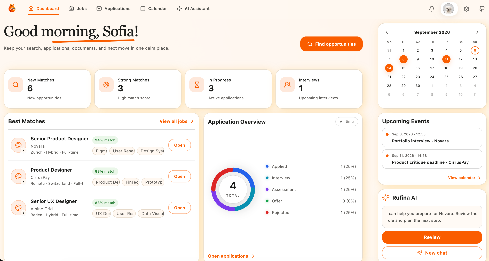
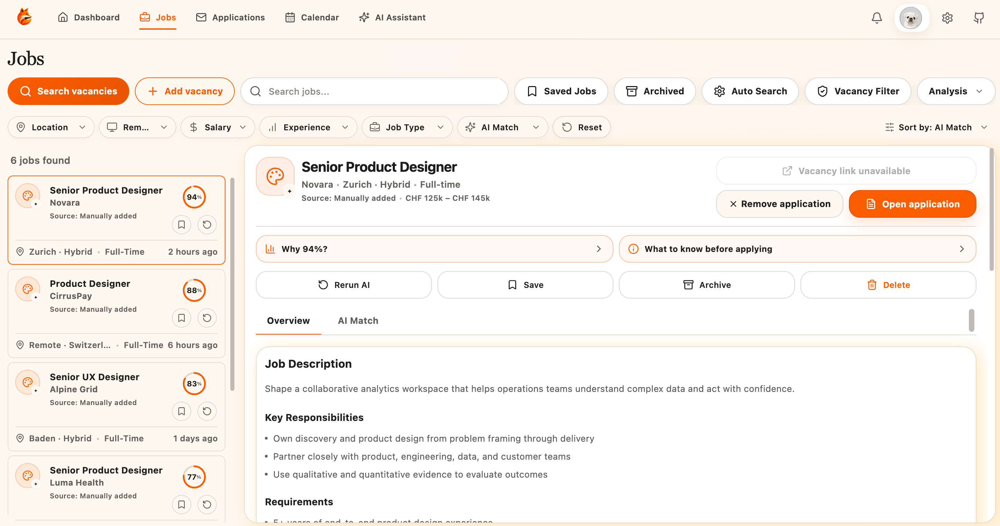

<h1 align="center">Personal AI Job Assistant</h1>

Rufina is a personal AI assistant for job hunting. It finds suitable job openings, assesses how well they match your profile, and tailors your resume and cover letters. The app also helps you store your documents and track the entire application process in one place.



## Key Features

 **Smart Job Search**: Automatically finds relevant opportunities on  LinkedIn,  Indeed, and other based on your preferences.

 **AI-Powered Matching**: Evaluates how well each vacancy matches your experience, skills, and career goals.

 **Tailored Resumes**: Adapts your resume to each position while keeping your professional background accurate.

 **Cover Letter Generation**: Creates personalized cover letters based on the vacancy, company, and your experience.

 **Application Tracking**: Keeps vacancies, documents, and application statuses organized in one workspace.

 **Candidate Profile**: Centralizes your professional experience, skills, and master resume.

 **Personal AI Assistant**: Supports you throughout the job search, from finding vacancies to preparing application documents.

## License

Rufina's source code is licensed under the
[GNU Affero General Public License v3.0](LICENSE).

Copyright © 2026 Rufina contributors.

The Rufina name, logo, and brand assets are not covered by the AGPL license.
See [TRADEMARKS.md](TRADEMARKS.md) for details.

## How It Works

1.  **Build Your Candidate Profile**
   Add your experience, skills, job preferences, and confirm your Master Resume.

2.  **Discover Relevant Vacancies**
   Search opportunities across LinkedIn, Indeed, jobs.ch, and other supported sources.

3.  **Review Your AI Match**
   See how each vacancy matches your profile, including strengths, gaps, and key requirements.

4.  **Prepare Your Application**
   Confirm important details, tailor your CV, generate a cover letter, and complete the final review.

5.  **Track Your Progress**
   Manage application statuses, next steps, interviews, assessments, and offers in one workspace.



## Getting Started

### Requirements

Choose one of the following setups:

- **Docker:** Docker Desktop or Docker Engine with Docker Compose.
- **Local development:** Node.js 22+, pnpm 9.15.0, Python 3.12+, PostgreSQL 16 with pgvector, and Redis 7.

Document processing also requires LibreOffice Writer, Poppler, Tesseract, and Playwright Chromium. These dependencies are installed automatically when using Docker.

### Clone the Repository

```bash
git clone https://github.com/vivalabit/rufina.git
cd rufina
```

### Configure Environment Variables

Create a `.env` file from the committed template:

```bash
cp .env.example .env
```

Edit `.env` before starting the application. `OPENAI_API_KEY` is required when
`AI_BACKEND=openai_api`. `BRIGHTDATA_API_KEY` is only required for LinkedIn and
Indeed searches.

### Run with Docker

Start the complete application stack:

```bash
docker compose up --build
```

Alternatively, use the project script:

```bash
pnpm docker:up
```

The default Compose configuration builds release images: Next.js is compiled
with `next build` and served with `next start`, while Uvicorn runs without
hot reload or a source-code bind mount. API readiness includes a database
probe, and dependent services wait for healthy containers.

Open the application at [http://localhost:3000](http://localhost:3000). The API is available at [http://localhost:8000](http://localhost:8000).

To stop the stack:

```bash
docker compose down
```

For Docker-based development with hot reload and source mounts, use the
development override:

```bash
pnpm docker:dev
```

Stop that stack with `pnpm docker:dev:down`.

### Run Locally with pnpm

Install the frontend dependencies:

```bash
corepack enable
corepack prepare pnpm@9.15.0 --activate
pnpm install --frozen-lockfile
```

Start PostgreSQL and Redis:

```bash
docker compose up -d postgres redis
```

Set up and start the API:

```bash
python3.12 -m venv .venv
source .venv/bin/activate
python -m pip install --upgrade pip
python -m pip install --constraint apps/api/constraints.txt --editable 'apps/api[dev]'
python -m playwright install chromium
cd apps/api
uvicorn app.main:app --reload --port 8000
```

In a separate terminal, start the web application from the repository root:

```bash
pnpm dev
```

The application will be available at [http://localhost:3000](http://localhost:3000).

Python package versions are pinned in `apps/api/constraints.txt`. After changing
`apps/api/pyproject.toml`, regenerate the constraints with:

```bash
uv pip compile apps/api/pyproject.toml --all-extras --universal --python-version 3.12 --upgrade --output-file apps/api/constraints.txt
```

## Configuration

Rufina reads configuration from the `.env` file in the repository root.

### API Keys

- `OPENAI_API_KEY` — required when using the OpenAI API directly.
- `BRIGHTDATA_API_KEY` — required for LinkedIn and Indeed vacancy search.
- `DEMO_MODE=1` — shows the Stripe/Figma example vacancies and sample calendar events. Demo data is disabled by default.
- jobs.ch, [Direct Companies](docs/direct-companies.md), and manually added
  vacancies do not require an API key.

### AI Providers

Rufina supports four AI backends:

- `openai_api` — OpenAI Responses API using your API key.
- `anthropic_api` — Anthropic Claude Messages API using your API key.
- `openclaw_codex` — Codex through a configured OpenClaw agent.
- `openclaw_claude` — Claude through a configured OpenClaw agent.

Each workload uses its own model, selectable in Settings. Defaults:

| Workload | OpenAI | Claude |
| --- | --- | --- |
| Vacancy pre-screening and vacancy parsing | GPT-6 Luna | Claude Haiku 5.5 |
| Full AI Match, assistant, profile import | GPT-6.1 Sol | Claude Sonnet 5.5 |
| Resume wording and cover letters | GPT-6.1 Sol | Claude Sonnet 5.5 (Claude Opus 5.5 optional) |

A saved model from another provider than the active backend is ignored and the
workload falls back to that provider's default.

```env
AI_BACKEND=openai_api
OPENAI_API_KEY=your_openai_api_key
OPENAI_API_MODEL=gpt-6.1-sol

BRIGHTDATA_API_KEY=your_brightdata_api_key
```

For OpenClaw and Codex:

```env
AI_BACKEND=openclaw_codex
OPENCLAW_COMMAND=openclaw
OPENCLAW_AGENT_ID=rufina-assistant
```

```bash
pnpm openclaw:setup
```

The agent allows GPT-6.1 Sol, GPT-6 Astra, and the selected screening model.
Use `pnpm openclaw:setup --screening-model openai/gpt-6.1-sol` to allow Sol for
screening, and select the same model in the application's AI settings. Additional
models can be registered with repeatable `--allow-model` arguments. Docker uses
Codex CLI 0.165.0 explicitly; the older CLI bundled with OpenClaw 2026.7.1 cannot
run these models.

For Claude directly:

```env
AI_BACKEND=anthropic_api
ANTHROPIC_API_KEY=your_anthropic_api_key
ANTHROPIC_API_MODEL=claude-sonnet-5-5
```

For Claude through OpenClaw:

```env
AI_BACKEND=openclaw_claude
OPENCLAW_ASSISTANT_MODEL=anthropic/claude-sonnet-5-5
```

```bash
pnpm openclaw:setup --provider anthropic
```

By default the agent runs Claude through the Claude Code CLI login on the same
host (`--claude-runtime claude-cli`). In Docker, log in once inside the API
container with `docker compose exec api claude`; the login is kept in the
`claude-cli-state` volume. Use `--claude-runtime openclaw` to call the Anthropic
API with the key configured in OpenClaw instead, and `--provider both` to allow
OpenAI and Claude models on the same agent.

### Application Document Pipeline

The application workspace runs document preparation as a recoverable server
workflow: source snapshot, fit approval, author draft, independent review, PDF
checks, and final review. The selected backend and all source/template versions
are frozen when a run starts. Changing `AI_BACKEND` affects only new runs.

- `AI_BACKEND=openai_api` uses the OpenAI Responses API with structured output,
  web search for the independent company review, and rendered-page image input
  for visual checks. Set `OPENAI_API_KEY`; the API key remains server-side.
- `AI_BACKEND=openclaw_codex` runs the same contracts through the configured
  OpenClaw agent. Run `pnpm openclaw:setup` and keep the OpenClaw volumes from
  `compose.yaml` mounted so the agent and its state are available to the API.
- The Docker API image includes LuaLaTeX, XeLaTeX, Poppler, the versioned fonts,
  and the original ModernCV/cover-letter assets. For local development install
  `lualatex`, `xelatex`, `pdftotext`, and `pdftoppm` on `PATH` before generating.
- `GENERATION_WORKER_POLL_INTERVAL_SECONDS` controls queue polling. Runs, events,
  raw provider responses, checks, source hashes, and final files are stored in
  PostgreSQL. Generated PDF checks are bound to the artifact SHA they validated.
- On API restart, an expired running lease is requeued and an audit event is
  recorded. Refreshing the browser restores the current run; a fit response and
  cancellation both use optimistic revisions to reject stale actions.

Only a successful final review publishes PDFs into the existing Documents
library. A requested correction starts a new immutable run and creates the next
version of the attached document. Opening an employer form and marking an
application submitted remain separate user actions.

### Vacancy Sources

- LinkedIn — through Bright Data
- Indeed — through Bright Data
- [jobs.ch](docs/jobs-ch-parser.md) — direct public search
- [Direct Companies](docs/direct-companies.md) — official company career pages
- Manual vacancy entry

### Search History

In Jobs, select **History** beside **Search vacancies** to review manual and
automatic searches. Filter by name, source, trigger or period, then open a report
to see source counts, processing time, attempts, errors and the saved search
settings. Select a count to inspect the vacancies and their processing reasons.
**View report** opens the latest report after a manual search finishes.

Configuration flows started by one manual search share a history entry. New
searches retain source and vacancy snapshots; older searches retain their
existing summary without invented source counts. Missing vacancies are reported
only after a successful complete company catalog scan. Limited search results
and failed or partial scans cannot establish that a vacancy disappeared.

Vacancy decisions copied into reports follow the AI data deletion and retention
settings. Search summaries remain available after these details are removed.

After fixing an AI provider failure, retry the failed decisions from saved
vacancies without scanning company websites again:

```bash
docker compose exec -T api python /workspace/scripts/retry_failed_job_screening.py \
  --source-run-id SEARCH_RUN_ID --model openai/gpt-6.1-sol --dry-run
```

Remove `--dry-run` to process the vacancies. Use `--max-batches 1` for a pilot,
then resume the returned run with `--recovery-run-id RECOVERY_RUN_ID`. Up to four
batches can run concurrently with `--workers 4`. Each batch is saved separately;
provider errors stop new batches. The retry retains the original filters and
creates its own history report, adding only approved vacancies.

## Stack

- **Frontend:** Next.js 16, React 19, TypeScript, Tailwind CSS
- **Backend:** Python 3.12, FastAPI, SQLAlchemy, Alembic
- **Database:** PostgreSQL 16 with pgvector
- **Queue and Cache:** Redis 7
- **AI:** OpenAI Responses API or Codex through OpenClaw
- **Documents:** LibreOffice, Poppler, Tesseract, Playwright
- **Infrastructure:** Docker Compose, pnpm workspaces

## Privacy & Security

- **Local storage:** Profiles, resumes, applications, and generated documents are stored in PostgreSQL. Docker keeps the database in the local `postgres-data` volume. Some workspace data is also cached in the browser’s local storage.
- **API keys:** OpenAI and Bright Data keys are stored server-side in `.env`, which is excluded from Git. Keys must never be exposed through `NEXT_PUBLIC_*` variables.
- **AI processing:** AI features require explicit consent. Relevant profile and resume text, vacancy details, confirmations, and document templates are sent to the selected provider: OpenAI directly or through OpenClaw/Codex.
- **Retention:** AI-generated data is kept for a configurable period of 1–365 days, with 30 days as the default. Users can revoke consent or delete stored AI data.
- **Provider policies:** Direct OpenAI requests use `store: false`, but external processing remains subject to the selected provider’s privacy and retention policies.
